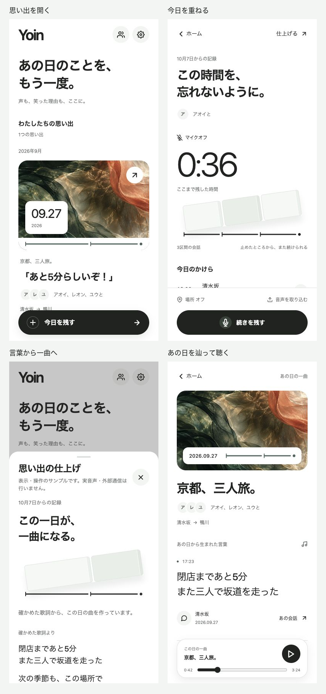

# Yoin: リッチなUIへの刷新の検証

Date: 2026-10-08

コンセプトは「小さな記憶のギャラリー」。設計と生成画像の記録は[設計](../../docs/premium-ui.md)、共通の判断は[Proposed ADR 0021](../../docs/adr/0021-memory-gallery.md)。最初の刷新は[前回の記録](../ui-refresh/README.md)として残す。

## 見返す

当時の検証用プレビューは実装した本物の画面コンポーネントを読み込む。表示データと録音・生成・再生の状態遷移はサンプルで、認証・永続保存・マイク・位置取得・有料APIは呼ばない。元会話シートの本文は操作確認用のサンプル。実アプリのログイン前表示だけはlocalhost:8081を確認した。

この記録は記載日のUI検証結果です。当時の検証用プレビューと画面は現行の受け入れ結果を示しません。現在の機能・実機検証の状態は[音声パイプラインの検証記録](../../docs/audio-pipeline-verification.md)を参照してください。 元画像は本物の画面をCodexブラウザーで撮影し、画像処理は一覧用の縮小・配置だけを行った。

## 表示と操作の確認

ブラウザーのサイズ指定がページへ反映されなかったため、`qa/ui-refresh/capture.html` のiframeで実際のレイアウト幅を390×840、320×640、546×840に固定し、DOMの寸法も確認した。外側のブラウザーをサイズ指定しただけの画像を390pxとして報告しない。[変更前のホーム](before/01-home.png)と[詳細](before/02-memory.png)は既定の546×853で撮影しており、同じ幅での比較には[刷新後の広い画面](after/18-wide-home.png)を参照する。

| 状態 | 確認した結果・証拠 |
| --- | --- |
| ホーム | 日付・実会話・参加者・場所と光の表紙を表示。[ホーム](after/01-home.png)。主操作は下部に一つ。546pxで表紙と操作はともにleft37、width472。[広い画面](after/18-wide-home.png)。 |
| 空・蓄積 | 空でも主操作が見える。[初めての一日](after/17-empty.png)。2026年9月→4月→2025年12月→日時の記録なしの順に4件を維持し、不明日時を作らない。[蓄積](after/19-months.png)。 |
| 参加者 | 未選択では開始不可。アオイとレオンを選択して開始すると両名を記録画面に引き継ぐ。[選択](after/04-participants.png)。 |
| 記録 | 12秒を3回保存し、3区間・36秒を反映。[記録中](after/05-recording.png)、[保存済み](after/06-recording-saved.png)。停止前の操作は3回ともtop760、bottom824、height64。位置表示が増えてもtop760、bottom824を維持。 |
| 位置 | 初期オフ、任意取得、既存の説明を保持。[位置](after/07-location.png)。実際のOS権限や測位は実行していない。 |
| 仕上げ・編集 | 3区間を維持し、空の名前は準備不可。[仕上げ](after/08-finish.png)。3つの編集欄が残り、空の歌詞では生成不可。元会話2発話を開いて編集へ戻れる。[歌詞](after/09-review.png)。 |
| シート切替 | 初期フォーカスは見える閉じるボタンへ置き、Enterで閉じる操作、本文の参加者選択、背景タップの復帰を確認。編集の末尾から生成へ進むと前のスクロールが残って見出しを欠くことを再現。シートの見出しが切り替わると本文を先頭へ戻す修正後、生成見出し全体が表示された。 |
| 準備・生成 | 歌詞のない準備段階は実際の保存日時・場所を表示。[準備](after/16-preparing.png)。生成段階は確認済み歌詞を表示し、仮の進捗率・即時文字起こしは表示しない。[生成](after/10-generating.png)。 |
| 失敗・受付不明 | 短いシートも縦スクロールで戻る操作に到達し、ホームへ戻れる。[失敗](after/13-failed-320.png)、[末尾](after/14-failed-scrolled-320.png)。受付不明は作り直せない旨を保持し、再送を追加しない。[受付不明](after/15-reconciliation.png)。 |
| 詳細・音声 | 曲だけでなく、参加者・場所・歌詞と出典を表示。[詳細](after/02-memory.png)。再生表示切替とシーク42→43秒、元会話2発話を開いて戻っても43秒を保持する模擬操作を確認。[元会話](after/03-source.png)。 |
| 狭い画面 | 320pxで長いタイトル・歌詞は折り返し、横はみ出しなし（root幅・scrollWidthとも320）。再生操作はtop539、bottom587。[長文](after/11-long-320.png)、[スクロール後](after/12-long-scrolled-320.png)。 |
| モーション | 詳細をスクロールすると表紙の移動が0から35pxになり、DOMのtransformでも確認。押下、言葉の出現、記録状態の点滅、シートspringを既存のAnimatedで実装する。 |
| ログイン前 | 本アプリで320×640のコピー・時間の帯・Googleログイン・プライバシーポリシーの入口が収まる。[入口](after/20-welcome-320.png)。ログインは実行していない。 |

## 自動チェック

Nixで固定した開発環境で実行。

- `npm run check`: 125ファイル、成功。
- `npm run typecheck`: 成功。
- `npm test`: 128件成功、0件失敗。既存の保存・生成・元会話の区間再生・録音から戻る回帰検証を含む。
- `npm run export`: Android / iOS / Webの3バンドル成功。新しい画像も同梱。
- `npm --prefix prototype run check:runtime`: 保護対象28ファイル、成功。プロトタイプを変更していない。
- `git diff --check`: 成功。

今回バックエンドと音声処理は変更していない。既存の作業途中の差分は保持した。

## アクセシビリティと検証の限界

主操作は44px以上。補助操作にもラベルを保ち、記録状態は文字・アイコンで伝える。実測した平面色のコントラストは本文/白15.86、補助文字/白5.29、補助文字/補助面4.83、アクセント/白6.35。画像上の日時と操作は白い面の上に置き、装飾の光の画像は読み上げ対象にしない。参加者の頭文字は装飾で、名前は全文を表示する。

Reduced Motionの分岐とアニメーションの停止・購読解除をコードで確認した。端末設定の切替、VoiceOver/TalkBack、Dynamic Type、ネイティブのキーボード・戻る・スワイプ、ノッチとホームバーは実機未確認。画像は同じ素材の切り取りで、実際の旅行の写真やAIによる感情推定ではない。白い帯の幅は保存時間、高さは装飾で、音量や進捗を表さない。

音声品質、実APIの文字起こし・生成、バックグラウンド録音・位置、永続化と再起動、認証、声登録、アカウント削除は今回実機・実APIで通して確認していない。サンプルでの成功を実機受け入れの成功として扱わない。[音声パイプライン設定](../../docs/audio-pipeline-setup.md)を参照する。
