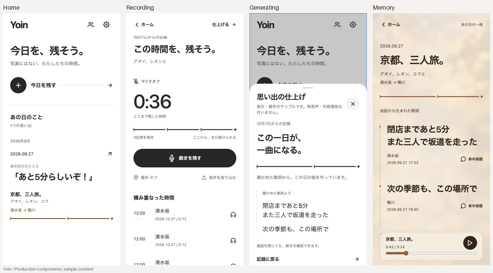

# Yoin UI刷新の検証

2026-10-07。コンセプトは「あの日を、辿って聴く。」。設計前の6項目は[設計記録](../../docs/ui-refresh.md)、複数画面に共通する判断は[Proposed ADR 0020](../../docs/adr/0020-memory-led-ui.md)に記録した。

## 見返す

当時の検証用プレビューで主要画面と境界ケースを切り替えて確認した。全体は本実装のコンポーネントを直接読み込む。表示データ・録音・生成・再生の状態遷移はサンプルであり、認証・保存・音声・位置取得・有料APIは呼ばない。元会話のシート内は操作確認用のサンプル文を表示する。完成は非同期APIを模して自動遷移させず、完成した記録のシナリオで個別に確認した。

この記録は記載日のUI検証結果です。当時の検証用プレビューと画面は現行の受け入れ結果を示しません。現在の機能・実機検証の状態は[音声パイプラインの検証記録](../../docs/audio-pipeline-verification.md)を参照してください。

## 画面の監査と操作確認

変更前後とも同じサンプルを使い、Codexのブラウザーで撮影した。主要画面は390×840、長文と短い画面は320×640。撮影した画面を保存して目視確認し、シートの開き途中や出典IDが一致しない古い検証用データの画像は撮り直した。

| 手順 | 状態 | 確認した内容と画面 |
| --- | --- | --- |
| 1. ホーム・思い出一覧 | 表示・操作良好 | 旧一覧は同じ仮ジャケットと曲名が中心だった。新一覧は実会話、録音日、参加者、場所で一日を区別する。[変更前](before/04-native-home.png)、[変更後](after/01-home.png)。空の一覧でも記録の入口が明確。[空](after/10-empty.png)。年月は2026年9月→4月→2025年12月→日時の記録なしの順に残る。[蓄積](after/11-months.png)。 |
| 2. 記録開始・参加者 | 操作良好 | 参加者0人では開始不可。アオイとレオンを選ぶと開始でき、記録画面へ両名が渡る。[選択](after/19-participants.png)。声の登録と実際の同意取得は未確認。 |
| 3. 記録・停止・再開 | 表示・模擬操作良好 | 大きなマイクを時間と保存区間の表示へ変更。[変更前](before/05-native-recording.png)、[変更後](after/04-recording.png)。12秒を3回保存し、3区間・36秒になる。区間追加前のボタン位置は3回ともtop483/bottom545/height62で一定。[保存済み](after/05-recording-saved.png)。位置はオフで開始し、任意の設定シートに初期設定・取得範囲の説明を保持。[位置](after/06-location.png)。 |
| 4. 名前・歌詞の確認 | 操作良好 | 全3区間が仕上げに残り、空の名前では準備不可。[仕上げ](after/07-finish.png)。準備後に3つの編集欄が残る。[歌詞](after/21-review-three.png)、[末尾へスクロール](after/22-review-three-scrolled.png)。空の歌詞では曲の生成不可。歌詞から出典の2つの会話を開け、戻って編集内容を維持できる。 |
| 5. 一曲になるまで | 表示・復帰良好 | 日時しかない送信・準備段階では日時を、確認済み歌詞のある生成段階ではその歌詞を見せる。[送信](after/12-uploading.png)、[準備](after/13-preparing.png)、[生成](after/09-generating.png)。進捗率・実時間の文字起こしは捏造しない。失敗時は保存済み内容から戻る。[失敗](after/14-failed.png)。受付不明では作り直せないことを明示し、再送操作を追加しない。[受付確認待ち](after/15-reconciliation.png)。 |
| 6. 思い出詳細・元会話 | 表示・模擬操作良好 | 旧詳細の重複するジャケットと曲名を減らし、歌詞、日時・場所、会話の入口を近くに置く。[変更前](before/06-native-memory.png)、[変更後](after/02-memory.png)、[元会話](after/03-source.png)。再生の表示切替とシーク42→43秒を確認。元会話へ移動しても位置43秒を維持する。実音源の再生と戻った後の再生再開は未確認。 |
| 7. 狭い画面・長文 | 表示・操作良好 | 320×640で長い名前と歌詞は折り返す。[先頭](after/16-long-320.png)、[スクロール](after/17-long-scrolled-320.png)。ページ自体の横はみ出しなし。再生ボタンはtop542.5/bottom588.5で画面内。短い画面のエラーシートは縦スクロールで戻るボタンへ到達できる。[短い画面](after/18-failed-320.png)。 |
| 8. ログインの入口 | 表示良好 | 本アプリのWeb画面で世界観のコピーとログイン・既存ポリシーの入口を確認。[入口](after/23-welcome.png)。ログイン以降は認証が必要なため本アプリでの通し操作は未確認。 |

## 自動検証

- `nix develop --command npm run check`: 121ファイル、成功。
- `nix develop --command npm run typecheck`: 成功。
- `nix develop --command npm test`: 128件成功、0件失敗。録音から戻る際の保存、生成、元会話の区間再生など既存の回帰検証を含む。
- 新しい表示規則のテストは、録音した現地年月、生成日との区別、日時不明、会話優先と歌詞への代替、場所の順序・重複除去を4件で確認。実装前のモジュール未存在でRED、実装後GREEN。
- `nix develop --command npm run export`: Android / iOS / Webの3バンドル成功。
- `nix develop --command npm --prefix prototype run check:runtime`: 保護対象28ファイル成功。プロトタイプは変更していない。
- `git diff --check`: 成功。

## アクセシビリティと証拠の限界

主要操作は44px以上、テキスト付き操作とスクリーンリーダー用のラベルを持つ。録音状態はアイコン・文字でも伝え、色だけに依存しない。実測した平面色のコントラストは墨/白14.87、補助文字/白5.78、完成記録の本文/基底色12.90、補助文字/基底色8.33。季節画像を含むすべてのピクセル上のコントラストを保証する測定ではない。

軌跡は保存クリップの長さを表す装飾で、音量や曲のシーク位置を意味しない。Reduced Motion時は新しい出現・記録状態のアニメーションを止めるコードを確認した。端末の設定を切り替えた動作、VoiceOver/TalkBackの読み上げ順、Dynamic Type、キーボード表示、ネイティブの戻る・スワイプ・シート操作、ノッチとホームバーを含む実機レイアウトは未確認。ブラウザー表示とモックテストの成功を実機の受け入れとは扱わない。

音声品質、実APIの文字起こし・生成、バックグラウンド録音・位置、永続化と再起動、認証、話者の登録、アカウント削除は既存処理を維持したが、今回実機・実APIでの通し確認は行っていない。手順は[音声パイプライン設定](../../docs/audio-pipeline-setup.md)を参照する。写真追加、同期歌詞、地図、Hapticsは今回追加していない。
